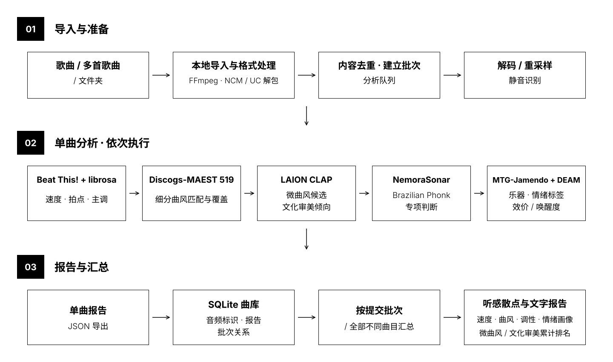
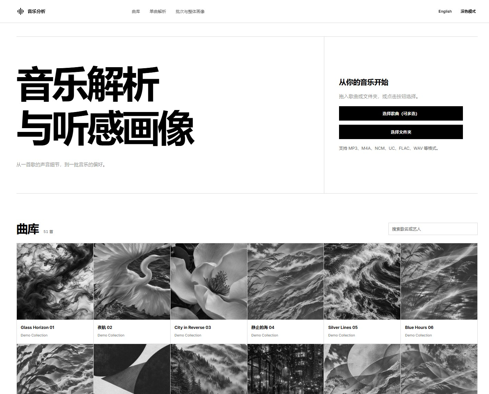
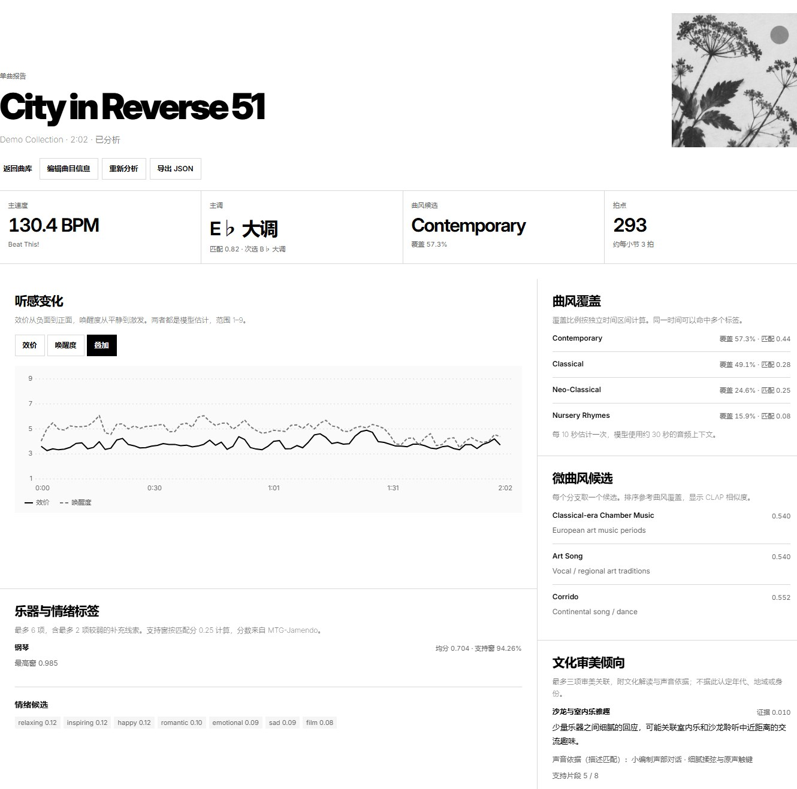
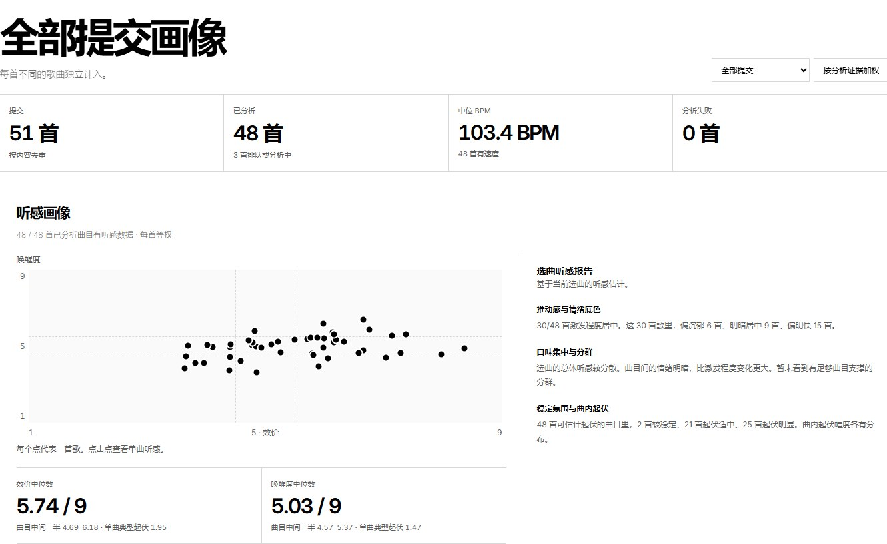
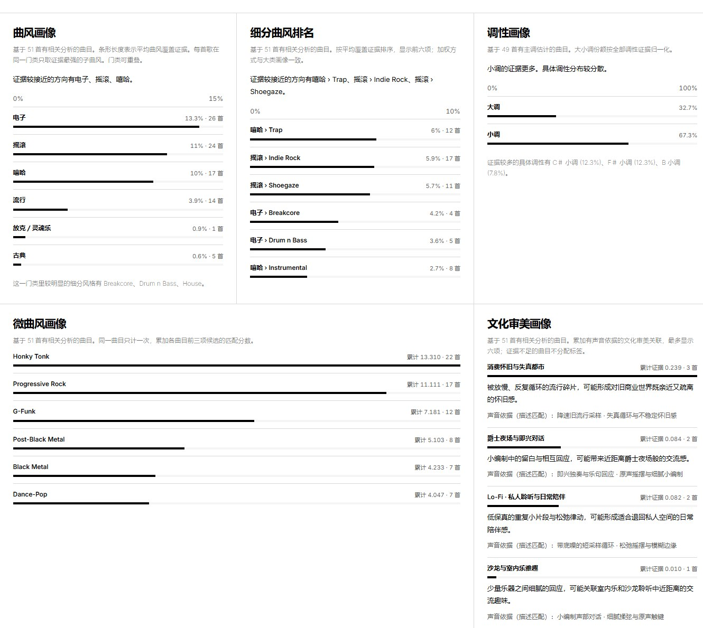

# MusicAnalysis · 音乐解析与听感画像

**从一首歌的声音细节，到一批音乐的偏好。**

## 1. 简介

MusicAnalysis 是一个面向 Windows 的本地音乐分析应用。导入歌曲或整个文件夹，就能查看曲风覆盖、微曲风候选、乐器与情绪线索、速度、调性和听感变化；提交多首后，还能对照这一批与全部曲库的选曲画像。

分析由多个音乐理解模型和信号处理模块共同完成，结果保留为可导出的结构化 JSON。首次安装联网下载依赖与权重，之后音频推理与曲库统计在本机执行，无需配置云端 AI API。

界面把导入、曲库、单曲解析与整体画像放在同一页，支持中文／English、浅色／深色主题。

## 2. 运作逻辑



图中顺序对应当前常规分析流程。曲目依次排队，模型按需加载；CLAP 排序会参考前一步的曲风证据。某个模块失败时记录原因，其他可用结果仍会展示。Beat This! 不可用时由 librosa 回退。

| 分析层 | 使用的模型或方法 | 页面中的结果 |
| --- | --- | --- |
| 曲风覆盖 | Discogs-MAEST，519 个标签 | 细分曲风、覆盖百分比、平均匹配分 |
| 微曲风 | LAION CLAP，音频与文本描述匹配 | 15 个上位门类中的细分候选，单曲最多 3 项 |
| 文化审美倾向 | CLAP 文化概念与两组声音描述对照、片段一致性及曲风兼容性检查 | [44 个文化概念](music_analysis/aesthetics.py)、审美解读和两组声音依据；单曲最多 3 项，也可以为空 |
| 乐器与情绪 | Discogs-EffNet + MTG-Jamendo 分类头 | 最多 6 项乐器线索，以及情绪候选 |
| 听感变化 | MSD-MusiCNN + DEAM | 随时间变化的效价、唤醒度及叠加曲线 |
| 速度与调性 | Beat This!、librosa、色度匹配 | 主速度、拍点数量、主调与接近的次选调 |
| Phonk 专项 | NemoraSonar 1.1，ONNX Runtime | 判断为 Brazilian Phonk 时，展示最多 3 个专项候选 |
| 批次与整体画像 | 本项目的去重、证据汇总与听感统计 | 维度图、描述性报告，以及微曲风／文化审美倾向前 6 名 |

## 3. 使用示例

截图中的曲名、艺人和批次名称做了匿名化处理，展示的是实际应用界面；仓库不提供这些曲目的音频。

### ① 导入一首歌，或一次提交整个文件夹

点击「选择歌曲（可多选）」或「选择文件夹」，也可以把歌曲或文件夹拖入导入区域。支持 MP3、M4A、NCM、UC、FLAC、WAV 等格式，子文件夹中的音频会一并提交。

每批最多 **50 首、合计 1 GiB**，单个文件最多 **120 MiB**。导入后依次分析，已有相同音频会复用记录并加入新批次。



### ② 打开单曲，核对不同层次的声音证据

点击曲库中的一张封套，查看主速度、主调、曲风覆盖、乐器与情绪标签，以及微曲风和文化审美倾向。听感曲线可切换效价、唤醒度或叠加显示；需要进一步处理时，点击「导出 JSON」。



### ③ 从多首歌，看到这一批选曲的共同倾向

在「批次与整体画像」选择某次提交或全部提交。散点中的每个点代表一首歌；旁边的文字报告解释推动感与情绪底色、选曲集中或分群，以及更偏稳定氛围还是明显起伏。点击点可继续查看对应单曲。



继续向下，可以比较曲风大类与细分排名、调性和情绪方向，并查看微曲风与文化审美倾向的累计前六名。



整体画像依据**提交过的不同音频**计算，与提交先后、播放次数和收听时长无关。同一曲目在同一汇总范围只贡献一次；微曲风和文化审美倾向累加各曲目的有效分数，显示累计值与贡献曲目数。

## 4. 技术与参考项目

后端使用 Python、FastAPI 和 SQLite；推理分别运行于 PyTorch、TensorFlow 和 ONNX Runtime。前端使用原生 JavaScript、CSS Grid 与 Canvas，字体和封套插画随源码提供，不依赖前端构建工具或在线字体服务。

| 来源 | 在本项目中的用途 |
| --- | --- |
| [MAEST 研究项目](https://github.com/palonso/MAEST) · [实际使用的 519 标签权重](https://huggingface.co/mtg-upf/discogs-maest-30s-pw-129e-519l) | 约 30 秒上下文的细分曲风分析 |
| [LAION CLAP](https://github.com/LAION-AI/CLAP) · [HTSAT Unfused 权重](https://huggingface.co/laion/clap-htsat-unfused) | 音频／文本特征与零样本语义匹配 |
| [Essentia / MTG 模型库](https://essentia.upf.edu/models.html) | Discogs-EffNet、MTG-Jamendo、MSD-MusiCNN 和 DEAM 模型图；本项目使用 TensorFlow 执行图，并实现对应音频前处理 |
| [Beat This!](https://github.com/CPJKU/beat_this) | 拍点与小节位置估计 |
| [librosa](https://github.com/librosa/librosa) | 频谱、色度、静音与速度分析，拍点回退 |
| [NemoraSonar](https://github.com/Nikenmar/NemoraSonar) | Brazilian Phonk 专项判断与细分风格 |
| [FFmpeg](https://ffmpeg.org/) · [imageio-ffmpeg](https://github.com/imageio/imageio-ffmpeg) | 解码、转码与播放格式适配 |
| [ncmdump](https://github.com/taurusxin/ncmdump) · [网易云缓存解码参考](https://github.com/poppinlp/netease-music-cache-decoder) | NCM 文件布局与 UC 缓存还原方式的参考 |
| [Inter](https://github.com/rsms/inter) | 本地加载的可变字体 |

本项目负责导入与去重、任务编排、跨模型证据处理、标签体系、画像统计和界面。上游模型从各自发布源按需下载，仓库不复制它们的训练工程。模型版本、下载来源与校验值见 [assets.py](music_analysis/assets.py)；完整的阈值、汇总公式及静音处理见[分析口径与计算说明](docs/analysis-methods.md)。

```text
MusicAnalysis/
├─ launch.py                 # 启动服务并打开浏览器
├─ Setup.ps1 / Start.cmd     # Windows 安装与启动入口
├─ music_analysis/
│  ├─ assets.py              # 模型来源、版本与文件校验
│  ├─ ingest.py / store.py   # 导入、去重、SQLite 与批次
│  ├─ models.py / signal.py  # 推理与音频信号分析
│  ├─ taxonomy.py           # 微曲风标签与统一目录
│  ├─ aesthetics.py         # 文化概念、双语解读与两组声音依据
│  ├─ culture.py            # 文化审美倾向证据筛选
│  ├─ summary.py            # 批次与整体画像
│  ├─ server.py             # 本地接口和分析队列
│  └─ web/                  # 单页界面、本地字体和装饰封套
└─ docs/                     # 使用截图与计算说明
```

## 5. 初步运行

当前安装脚本面向 **Windows x64 + Python 3.12**，建议使用较新的 Edge 或 Chrome。CPU 即可运行，首次安装需要联网，并为 Python 依赖、权重和临时解压保留数 GiB 空间。

```powershell
git clone https://github.com/White-Lulu/MusicAnalysis.git
cd MusicAnalysis
python --version  # 应为 Python 3.12.x
powershell -ExecutionPolicy Bypass -File .\Setup.ps1
.\Start.cmd
```

安装完成后，以后直接双击 `Start.cmd`。浏览器打开 **http://127.0.0.1:8765**，关闭启动命令窗口即可停止服务。首次加载各模型比后续分析慢。

安装脚本只准备推理环境，并移除未使用的 PyTorch／TensorFlow 开发头文件与 PyTorch 静态链接库。模型、运行 DLL 和必要依赖保留；不会把上游训练代码、模型权重或 Python 环境提交到 GitHub。

### 数据位置与可选配置

| 路径或变量 | 作用 |
| --- | --- |
| `data/uploads/` | 导入后供分析使用的音频副本 |
| `data/library.sqlite3` | 曲目信息、报告、批次关系和标签设置 |
| `data/features/clap/` | 可复用的小型片段特征缓存 |
| `models/` | 自动下载的模型权重与相关文件 |
| `MUSIC_ANALYSIS_DATA` / `MUSIC_ANALYSIS_MODELS` | 更改数据与模型目录 |
| `MUSIC_ANALYSIS_PORT` | 修改端口，默认 `8765` |
| `MUSIC_ANALYSIS_THREADS` | PyTorch CPU 线程数，默认 `4` |
| `MUSIC_ANALYSIS_DEVICE` | 默认 `cpu`；自行配置兼容 CUDA 版 PyTorch 后可设为 `cuda` |

迁移已有曲库时，一起保留音频文件和数据库；旧记录可能仍引用原音频路径。当前服务监听回环地址，按单用户设计。公开网站部署还需增加用户隔离、上传鉴权和独立任务队列。

## 6. 补充说明

- **百分比的含义不同。** 曲风覆盖率表示达到阈值的有效片段覆盖全曲多少时长，多个曲风可重叠，总和不要求为 100%。微曲风显示 CLAP 相似度，文化审美倾向显示对照证据分；它们均不是“属于这个标签的概率”。
- **文化审美倾向可以为空。** 它将文化概念、简短审美解读与两组通过匹配的声音依据一起展示。单个制作特征不会直接成为文化标签；概念和两组声音描述必须在相同片段得到支持，还会检查曲风语境、人声条件与相近概念的歧义。它不能证明发行年代、地域或文化身份，不会强制补足三个标签。
- **听感画像描述选曲。** 它用于观察这批音乐的推动感、情绪底色与变化幅度，不据此推断用户的性格或心理状态。
- **音色与实体乐器存在歧义。** 采样、合成器模拟、混音遮蔽和弱音都可能造成漏判或误判。细分风格与文化标签也尚未完成独立、全面的准确率评测。
- **导入副本统一为 MP3。** 原始 MP3 和 NCM 中的 MP3 尽量流复制，其他可解码格式转换为 320 kbps、48 kHz 立体声 MP3；无损源会发生有损压缩。请另行保留需要归档的原文件。NCM／UC 支持取决于文件变体，QMC／KGM 等不在当前支持范围内。
- **截图中的封套是装饰。** 内置六款图案由 AI 生成，与歌曲真实专辑封面无关。原始音乐、曲库数据库、分析缓存和模型文件均由 `.gitignore` 排除。

逻辑与迁移回归检查可在安装依赖后运行：

```powershell
.venv/Scripts/python.exe -B -m unittest discover -s tests -v
```

## 7. 许可证

本项目自有应用代码与文档采用 [MIT License](LICENSE)。第三方字体、模型、模型附带代码及运行依赖保留各自许可证，详见[第三方来源与授权](THIRD_PARTY_NOTICES.md)。

MTG 发布的模型总体采用 **CC BY-NC-SA 4.0**；本项目所用 MAEST Hugging Face 转换页的许可字段未完整填写，需同时核对原模型与转换版本的授权。应用代码的 MIT 许可不授予第三方模型的商业使用权。模型授权说明见 [MTG 官方页面](https://essentia.upf.edu/licensing_information.html)。用户导入的音频仍归其各自权利人所有。
