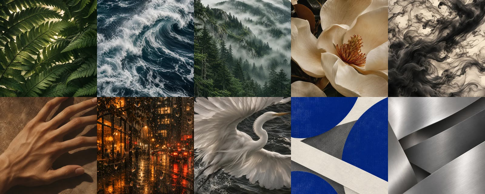

# 十款装饰封套

这套封套使用内置 imagegen 工具生成，共十款。构图采用满版裁切与克制配色，题材包含自然、人物局部、都市摄影、流体和两款几何材质。封套仅用于视觉区分，不参与音乐分析，也不代表歌曲真实专辑或曲风。



1. **叶影**：[01-botanical-shadow.webp](../music_analysis/web/sleeves/01-botanical-shadow.webp)
2. **潮汐**：[02-ocean-nocturne.webp](../music_analysis/web/sleeves/02-ocean-nocturne.webp)
3. **山岚**：[03-mountain-mist.webp](../music_analysis/web/sleeves/03-mountain-mist.webp)
4. **花序**：[04-ivory-bloom.webp](../music_analysis/web/sleeves/04-ivory-bloom.webp)
5. **墨流**：[05-ink-drift.webp](../music_analysis/web/sleeves/05-ink-drift.webp)
6. **触感**：[06-human-gesture.webp](../music_analysis/web/sleeves/06-human-gesture.webp)
7. **夜雨**：[07-city-after-rain.webp](../music_analysis/web/sleeves/07-city-after-rain.webp)
8. **掠羽**：[08-heron-flight.webp](../music_analysis/web/sleeves/08-heron-flight.webp)
9. **群青**：[09-cobalt-interlock.webp](../music_analysis/web/sleeves/09-cobalt-interlock.webp)
10. **银折**：[10-silver-facets.webp](../music_analysis/web/sleeves/10-silver-facets.webp)

## 生成提示词

以下为最终选用的提示词。01–08 使用共同提示 A，09–10 使用共同提示 B；每次生成的完整提示为相应共同提示与该款题材提示两段拼接。

<details>
<summary>共同提示 A：自然、人物与都市题材</summary>

```text
Create one original SQUARE album-cover artwork for a sophisticated modern music gallery. Full-bleed, visually rich composition: the recognizable subject and its organic details extend through the ENTIRE frame and are cropped naturally at the edges. Tight immersive framing, strong focal structure, subtle fine-art photographic grain, controlled contrast and a restrained harmonious palette. Contemporary, elegant, clear, with enough layered detail to reward looking closely. Every region participates; no tiny isolated object, no large blank background, no empty upper half. The subject here is natural or photographic, not an abstract geometric sculpture, paper-fold relief or arrangement of blocks. This is the artwork itself, no album mockup. No text, typography, letters, numbers, logos, watermark, frame, montage or grids.
```

</details>

<details>
<summary>共同提示 B：满版几何题材</summary>

```text
Create one original SQUARE album-cover artwork: a visually full, edge-to-edge abstract composition in a refined contemporary minimalist style. This is the artwork surface itself. CRITICAL COMPOSITION: large interlocking forms and material planes must span the WHOLE canvas, reaching and being cropped by all four edges. Use an intimate macro crop and several overlapping elements so every part of the picture participates; background exists only as narrow or shaped intervals between forms. Strong overall structure, generous scale, layered depth, extremely deliberate rhythm. Avoid small isolated objects, empty upper halves, a tiny object on a blank backdrop, distant still-life scenes and excessive blank margins. Keep a restrained palette and simple coherent geometry, elegant tactile surfaces, subtle natural lighting, beautiful modern abstract-art direction. No text, letters, numbers, logos, watermark, frame, album mockup, split panels or grids. No busy ornament, rainbow neon or gratuitous glossy CGI.
```

</details>

<details>
<summary>01-botanical-shadow · 叶影</summary>

```text
Close-up fine-art botanical photograph of overlapping deep forest-green fern fronds, with beautifully readable individual leaflets, veins, subtle natural imperfections and layered shadows. Fronds cross diagonally in front of one another and extend off all edges, the full picture alive with botanical structure. A small amount of soft ivory backlight shines through narrow gaps. Dark green, black-green and warm ivory only. A sophisticated lush natural composition, not a repeating graphic pattern.
```

</details>

<details>
<summary>02-ocean-nocturne · 潮汐</summary>

```text
An overhead fine-art photograph of a single powerful breaking ocean wave, its sculptural white foam curling diagonally across deep ink-blue water. Intricate natural foam branches and smaller eddies populate the entire square. No horizon or sky. A large dynamic wave fills and exceeds the frame, elegant broad dark-to-white contrast with subtle storm-grey tonal layers, no artificial neon colors or oversaturated turquoise.
```

</details>

<details>
<summary>03-mountain-mist · 山岚</summary>

```text
A close, compressed landscape photograph of a rugged mountain ridge and dense conifer forest threaded with low mist. Layered near-black forest detail fills the lower and side regions; pale fog winds through the center between recognizable rocky and wooded slopes. A further misty ridge reaches the top edge. Rich frame-wide natural depth, not a small mountain beneath a huge blank sky. Restrained charcoal, soft jade-grey and off-white, contemporary fine-art landscape mood.
```

</details>

<details>
<summary>04-ivory-bloom · 花序</summary>

```text
An extreme close-up fine-art photograph of one large ivory magnolia flower opening across the whole square. Broad delicate petals overlap and curl off the image edges, clear natural petal veins and a small warm rust-colored stamen cluster create a recognizable flower rather than abstract paper ribbons. Deep charcoal botanical shadows appear only in shaped gaps. Cream, warm white, muted rust and near-black; elegant, tactile and quietly dramatic, not a flower isolated against a large empty backdrop.
```

</details>

<details>
<summary>05-ink-drift · 墨流</summary>

```text
Organic sumi-black ink suspended in water, photographed extremely close as dense flowing plumes, branching filaments and translucent smoky layers spread across the entire square. A strong free-flowing diagonal current, rich natural marbling and soft grey diffusion fill every corner, with warm ivory water revealed only between plumes. It should feel like fluid motion, not brush lettering, paper folds, concentric circles or geometric forms. Refined monochrome abstract organic art, no container visible.
```

</details>

<details>
<summary>06-human-gesture · 触感</summary>

```text
An intimate fine-art photographic study of one adult human hand and its shadow, viewed close enough that the wrist enters one edge and relaxed gracefully spread fingers extend toward and beyond the opposite edges. The hand itself occupies most of the composition; warm desaturated skin texture, subtle creases, soft side light and a deep graphite shadow create a strong organic silhouette. Anatomically correct single hand with five fingers, no extra limbs, no jewelry, no props, no face. Restrained warm monochrome, elegant and expressive, not clinical.
```

</details>

<details>
<summary>07-city-after-rain · 夜雨</summary>

```text
A fine-art nocturnal city photograph seen through rain-speckled glass. Large translucent droplets in the foreground overlap softly blurred warm building windows, streaked street lights and wet-street reflections that extend throughout the entire square. The layered image clearly evokes an urban night after rain, with strong controlled amber and muted red highlights against graphite-black. Atmospheric photographic depth, full frame, no empty sky, no readable signs, no rainbow neon, no futuristic CGI.
```

</details>

<details>
<summary>08-heron-flight · 掠羽</summary>

```text
A close-cropped fine-art photograph of a white heron taking flight over dark water. One great feathered wing sweeps across the upper and left edges, the second wing and body fill the lower region, while the elegant curved neck and slender head remain recognizably visible near the right side. Detailed natural feathers, subtle motion, dramatic soft light and textured dark water in the remaining gaps. Full-frame animal presence, not a small bird on a blank background. Ivory, cool grey and near-black, graceful contemporary photographic album art.
```

</details>

<details>
<summary>09-cobalt-interlock · 群青</summary>

```text
Deep ultramarine-blue circular segments, broad chalk-white paper strips and a single graphite plane interlock across the entire square. Oversized circles extend beyond the top and right edges; white planes cut through them at clean oblique angles. Three or four layers, rich precise screenprint texture, confident graphic rhythm, no broad unused white background.
```

</details>

<details>
<summary>10-silver-facets · 银折</summary>

```text
A tightly cropped architectural composition made entirely of folded satin-brushed aluminum planes. Four large diagonal silver and charcoal facets meet and overlap, filling the frame with crisp seams, muted reflections and deep narrow shadows. Some folds exit every image edge. Restrained monochrome luxury, beautiful physical material, no central small metal object.
```

</details>
